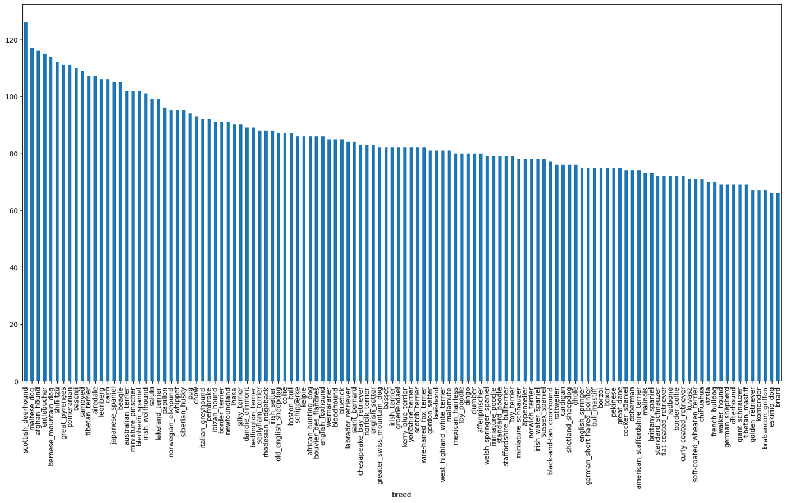
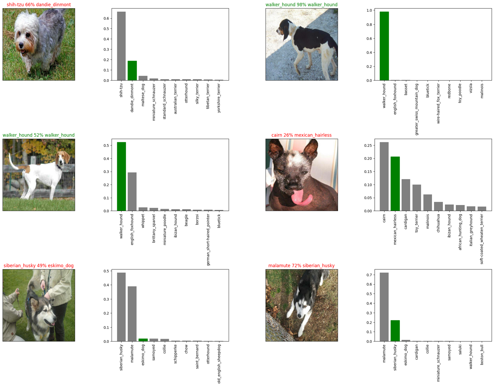

# End-to-End Multi-Class Dog Breed Classification


-F9AB00?logo=googlecolab&logoColor=white)

[](LICENSE)

[](https://colab.research.google.com/github/vjabarca/DL-Multi-Class-Dog-Breed-Classification/blob/main/dog-vision.ipynb)

An image classifier that identifies a dog's breed from a photo, built with TensorFlow and **transfer learning**. A pretrained MobileNetV2 from TensorFlow Hub is frozen and a new 120-way softmax layer is trained on top of it, using the Kaggle [Dog Breed Identification](https://www.kaggle.com/competitions/dog-breed-identification) dataset.

The motivating use case: you're at a cafe, you take a photo of a dog, and you want to know what breed it is.

## Table of Contents

- [Overview](#overview)
- [Dataset](#dataset)
- [Model Architecture](#model-architecture)
- [Results](#results)
- [Tech Stack](#tech-stack)
- [Installation](#installation)
- [Usage](#usage)
- [Configuration](#configuration)
- [Project Structure](#project-structure)
- [Known Issues & Limitations](#known-issues--limitations)
- [Roadmap](#roadmap)
- [Contributing](#contributing)
- [License](#license)
- [Author & Support](#author--support)
- [Acknowledgments](#acknowledgments)

## Overview

Images are unstructured data, so the notebook uses deep learning with transfer learning instead of training a network from scratch. It follows the full workflow:

1. Explore the labels and check class balance
2. Turn image files into normalized 224x224 tensors and batch them with `tf.data`
3. Build a Keras model on top of a pretrained TF Hub MobileNetV2
4. Train first on a 1,000-image subset (800 train / 200 validation) to confirm everything works
5. Visualize predictions and top-10 confidences
6. Save and reload models, train on the full data, and predict on the test set
7. Export a Kaggle-format submission CSV
8. Predict on custom photos

## Dataset

[Kaggle Dog Breed Identification](https://www.kaggle.com/competitions/dog-breed-identification/data):

| | Count |
|---|---|
| Labeled training images | 10,222 |
| Unlabeled test images | 10,357 |
| Breeds (classes) | 120 |
| Median images per breed | 82 |

The class distribution is fairly balanced, with the largest class (`scottish_deerhound`) at 126 images.



The data is not included in this repository. Download it from Kaggle (terms apply).

## Model Architecture

```text
224x224x3 image (scaled to 0-1)
   -> hub.KerasLayer(MobileNetV2 130_224, frozen)   -> 1001 outputs
   -> Dense(120, softmax)                           -> probability for each breed
```

| Setting | Value |
|---|---|
| Pretrained model | [`mobilenet_v2_130_224/classification/4`](https://tfhub.dev/google/imagenet/mobilenet_v2_130_224/classification/4) (TF Hub) |
| Parameters | 5,552,953 total, 120,240 trainable |
| Loss / optimizer | Categorical cross-entropy / Adam |
| Batch size | 32 |
| Callbacks | TensorBoard, early stopping (patience 3) |
| Labels | One-hot boolean arrays over the 120 sorted breed names |

## Results

**Experiment on 1,000 images (800 train / 200 validation).** Early stopping ended training at epoch 12:

| Metric | Train | Validation |
|---|---|---|
| Accuracy | 100% | 64.0% |
| Loss | 0.031 | 1.28 |

The large gap between training and validation accuracy shows overfitting on such a small subset, which is expected here. The same model reloaded from its saved `.h5` file scored 63.5% on the same validation set.

**Full training set (10,222 images).** Training ran for 22 epochs (about 9 minutes per epoch on a Colab T4 GPU), reaching 99.9% training accuracy. There is no validation split in this run, so early stopping watched training accuracy and there is no held-out accuracy figure for it.

**Kaggle submission:** multi-class log loss of **1.40642** (lower is better). See [Known Issues](#known-issues--limitations) for a note on which model produced the submission file.

Example validation predictions (title: predicted breed, confidence, true breed; green means correct). The bar charts show the top-10 predicted breeds with the true breed in green:



Many of the errors are between visually similar breeds (for example Siberian husky vs. malamute, and Siberian husky vs. Eskimo dog), and the true breed is often in the top 10.

**Custom photos.** The notebook also runs the model on seven personal images. Corgi photos were labeled `pembroke` and a chihuahua was labeled `chihuahua`. Australian shepherd photos were misclassified, which is expected because that breed is not one of the 120 classes.

## Tech Stack

- **Language:** Python 3
- **Deep learning:** TensorFlow 2.19, `tf_keras`, TensorFlow Hub 0.16.1
- **Data:** pandas, NumPy, scikit-learn (`train_test_split`)
- **Visualization:** Matplotlib, TensorBoard
- **Environment:** Google Colab with a GPU, Google Drive for storage

## Installation

### Option A: Google Colab (as the notebook was written)

1. Click the **Open In Colab** badge above.
2. Choose **Runtime > Change runtime type > GPU**.
3. Download the data from [Kaggle](https://www.kaggle.com/competitions/dog-breed-identification/data) and upload `dog-breed-identification.zip` to Google Drive.
4. Mount Drive and unzip into a folder with `train/`, `test/`, and `labels.csv`, then update the paths in the notebook (see [Configuration](#configuration)).

### Option B: Run locally

```bash
# 1. Clone the repository
git clone https://github.com/vjabarca/DL-Multi-Class-Dog-Breed-Classification.git
cd DL-Multi-Class-Dog-Breed-Classification

# 2. Create and activate a virtual environment
python -m venv .venv
source .venv/bin/activate        # Windows: .venv\Scripts\activate

# 3. Install dependencies
pip install tensorflow==2.19.0 tf_keras tensorflow-hub pandas numpy scikit-learn matplotlib jupyter

# 4. Launch the notebook
jupyter notebook dog-vision.ipynb
```

A GPU is strongly recommended. Training on the full dataset on a CPU would be very slow.

## Usage

1. Run the setup cells (imports, GPU check) and load `labels.csv`.
2. Build the file path list and the one-hot labels, then split into train and validation sets. Start with the 1,000-image subset by leaving `NUM_IMAGES = 1000`.
3. Create the batches and the model, then train:

   ```python
   train_data = create_data_batches(X_train, y_train)
   val_data   = create_data_batches(X_val, y_val, valid_data=True)
   model = train_model()
   ```

4. Inspect predictions with `plot_pred()` and `plot_pred_conf()`.
5. Train on all labeled data:

   ```python
   full_data  = create_data_batches(X, y)
   full_model = create_model()
   full_model.fit(x=full_data, epochs=NUM_EPOCHS, callbacks=[...])
   ```

6. Predict on the test set and write the Kaggle CSV (`preds_df.to_csv(..., index=False)`).
7. Predict on your own photos:

   ```python
   custom_data  = create_data_batches(custom_image_paths, test_data=True)
   custom_preds = loaded_full_model.predict(custom_data)
   labels = [get_pred_label(p) for p in custom_preds]
   ```

## Configuration

Paths in the notebook point to a specific Google Drive folder. Update these to match your setup:

| What | Where in the notebook |
|---|---|
| `labels.csv` and `train/` folder | Label loading and `filenames` cells |
| `test/` folder | `test_path` |
| `logs/` (TensorBoard), `models/` (saved models) | `create_tensorboard_callback()`, `save_model()` |
| `my_dog_photos/` (custom images) | `custom_path` |

| Variable | Default | Purpose |
|---|---|---|
| `NUM_IMAGES` | 1000 | Size of the experiment subset |
| `IMG_SIZE` | 224 | Image side length expected by the model |
| `BATCH_SIZE` | 32 | Images per batch |
| `NUM_EPOCHS` | 100 | Maximum epochs (early stopping usually ends sooner) |

No API keys are needed. Kaggle downloads require a Kaggle account.

## Project Structure

```text
.
├── dog-vision.ipynb                  # full workflow: data, model, training, prediction
├── docs/
│   ├── breed_distribution.png        # images per breed
│   └── validation_predictions.png    # sample predictions and top-10 confidences
├── LICENSE
└── README.md
```

Not included (create or download them yourself): the Kaggle data, saved models (`.h5`), TensorBoard logs, and prediction CSVs.

## Known Issues & Limitations

- **Submission model mix-up:** the cell that saves the "full image set" model calls `save_model(model, ...)`, which saves the 1,000-image model rather than `full_model`. The next cells reload that file as `loaded_full_model` and use it for the test predictions and the Kaggle submission. The submission therefore reflects the 800-image model, not the model trained on all 10,222 images. Fix: save `full_model`, reload it, regenerate the predictions, and resubmit.
- **No held-out score for the full model:** it trains on all labeled data, so its accuracy is only measured on training data.
- **Overfitting:** training accuracy reaches nearly 100% while validation accuracy stays far lower. There is no data augmentation, dropout, or fine-tuning.
- **Closed set of 120 breeds:** the model cannot recognize breeds outside the list and returns a confident-looking wrong answer instead.
- **Machine-specific paths:** all paths point to a Google Drive folder, so the notebook needs edits to run elsewhere.
- **Classification variant used as features:** the TF Hub URL is the ImageNet classification model (1,001 outputs). The `feature_vector` variant is the more conventional choice for transfer learning.
- **Batch size parameter:** `create_data_batches()` always uses the global `BATCH_SIZE`, ignoring its `batch_size` argument.
- **Slow predictions:** predicting the 10,357 test images took about 30 minutes on a Colab T4 GPU.
- **Legacy Keras:** the notebook uses `tf_keras` to stay compatible with `hub.KerasLayer` in recent TensorFlow versions.

## Roadmap

- [ ] Fix the model-saving bug, regenerate predictions, and update the Kaggle score
- [ ] Add a proper train/validation/test protocol (or cross-validation) for the full-data model
- [ ] Add data augmentation and try fine-tuning the top layers of MobileNetV2
- [ ] Compare other pretrained backbones (EfficientNet, ResNet)
- [ ] Add a confusion matrix (listed as a challenge in the notebook) and per-breed accuracy
- [ ] Add a `requirements.txt` with pinned versions
- [ ] Make paths configurable so the notebook runs locally or on Colab without edits
- [ ] Wrap the model in a small demo app (upload a photo, get the top-5 breeds)

## Contributing

Contributions, bug reports, and feature ideas are welcome.

1. **Report a bug or request a feature:** open an [issue](https://github.com/vjabarca/DL-Multi-Class-Dog-Breed-Classification/issues) and include what you expected, what happened, and your environment (Colab or local, TensorFlow version).
2. **Submit a change:**
   1. Fork the repository
   2. Create a branch: `git checkout -b feature/your-feature`
   3. Commit your changes with a clear message
   4. Push the branch and open a pull request describing what changed and why

Please keep notebook outputs small before committing.

## License

Distributed under the MIT License. See [`LICENSE`](LICENSE) for details. The Kaggle dataset and the pretrained MobileNetV2 weights have their own terms and are not covered by this license.

## Author & Support

**Victor J. Abarca**, San José, CA

- GitHub: [@vjabarca](https://github.com/vjabarca)

For questions or problems, please open an issue in this repository.

## Acknowledgments

- [Kaggle](https://www.kaggle.com/competitions/dog-breed-identification) for the Dog Breed Identification dataset
- [TensorFlow](https://www.tensorflow.org/) and [TensorFlow Hub](https://www.tensorflow.org/hub) for the framework and the pretrained MobileNetV2
